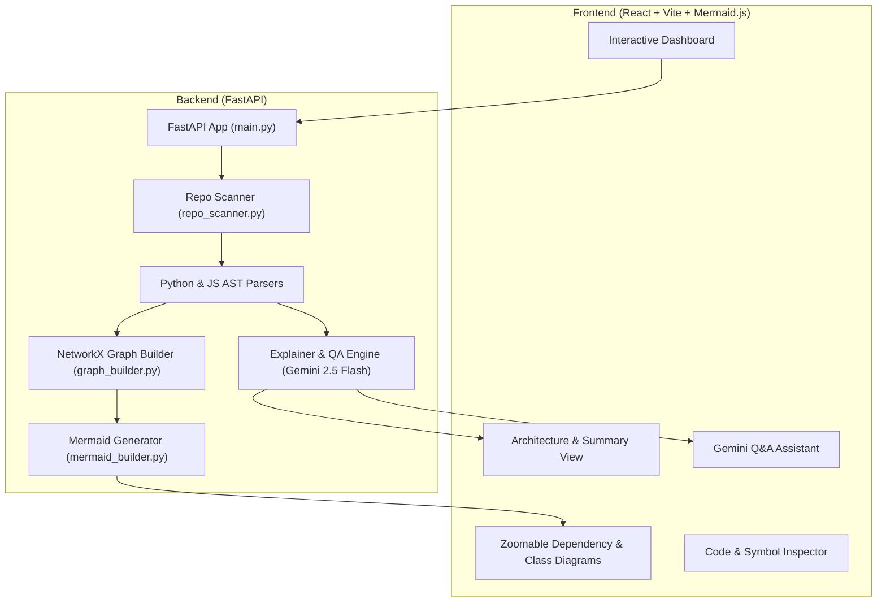

# Project Explainer 🚀
### Automated Codebase Summarization, Interactive Graph Visualizer & Plain-Language AI Architecture Explorer

Project Explainer is a developer tool that analyzes codebases, generates interactive architectural flowcharts and dependency graphs, and answers deep architectural questions using **AST analysis**, **NetworkX**, **Mermaid.js**, and the **Gemini 2.5 Flash API**.

---

## 🌟 Key Features

1. **AST & Symbol Extraction**:
   - Parses Python files using Python's native `ast` parser (classes, methods, functions, decorators, function calls, module docstrings).
   - Parses JavaScript/TypeScript/JSX files for imports, exports, and functions.
   - Extracts repository metadata, manifests (`package.json`, `requirements.txt`), and README summaries.

2. **Directed Dependency & Call Graph Engine**:
   - Powered by **NetworkX**.
   - Resolves internal relative and package imports.
   - Detects circular dependencies and identifies high-coupling modules (most depended upon).

3. **Dynamic Mermaid Diagram Visualizer**:
   - **Architectural Layers Diagram**: Categorizes code into Presentation, API/Controllers, Domain Logic, and Parsers/Infrastructure.
   - **Inter-Module Dependency Flowchart**: Clustered by directories with zoom, pan, reset, and SVG export.
   - **Class & Inheritance Hierarchy**: Visualizes class hierarchies and methods.

4. **Code & Symbol Inspector**:
   - Interactive directory tree explorer.
   - Inspects classes, functions, arguments, and full source code with line numbers.

5. **Plain-Language Explanations & RAG Q&A (Dual Mode)**:
   - **Heuristic Mode**: Works 100% offline out-of-the-box without requiring an API key.
   - **Gemini AI Mode**: Connect a Gemini API Key directly in the UI to unlock generative architectural breakdowns, execution flow walkthroughs, and conversational repository Q&A.

---

## 🏗️ Architecture



---

## ⚡ Quick Start

### 1. Launch Everything (One Click)

Double click or run:
```powershell
.\run_app.bat
```
This automatically starts:
- **Backend**: `http://127.0.0.1:8000` (FastAPI)
- **Frontend**: `http://localhost:5173` (Vite + React)

---

### 2. Manual Startup

#### Backend
```powershell
# In project root
python -m uvicorn backend.app.main:app --host 127.0.0.1 --port 8000 --reload
```

#### Frontend
```powershell
cd frontend
npm run dev
```

Then visit **`http://localhost:5173`** in your browser.

---

## 🔑 Gemini API Configuration

1. You can enter your Gemini API Key directly in the UI by clicking the **Heuristic Mode / Gemini AI Active** pill in the top navigation bar.
2. Alternatively, set an environment variable:
   ```powershell
   $env:GEMINI_API_KEY="your-api-key-here"
   ```

---

## 📡 API Endpoints

- `GET  /api/health` — Service health check.
- `POST /api/scan` — Scans a directory path, extracts AST, builds dependency graph, and generates diagrams.
- `POST /api/upload-folder` — Uploads an entire project folder preserving directory structure.
- `POST /api/upload-zip` — Uploads and unpacks a .zip project archive.
- `POST /api/clone` — Clones a Git or GitHub repository.
- `GET  /api/file?path=...` — Returns file content and parsed AST symbols.
- `POST /api/ask` — Plain-language Q&A powered by relevant AST context and Gemini.
